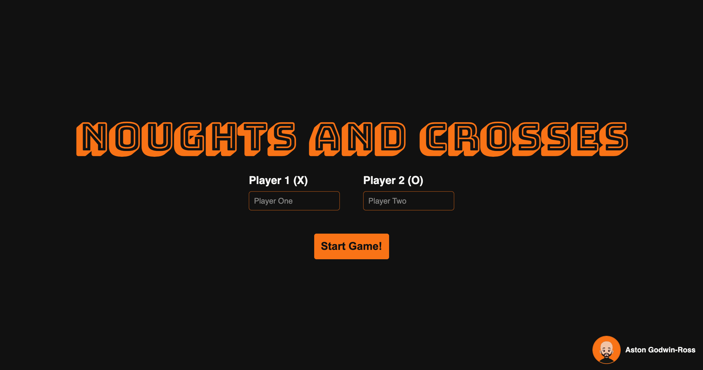
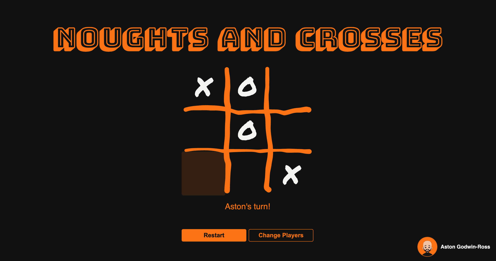

# Noughts and Crosses

A two-player noughts and crosses (tic-tac-toe) game for the browser. Players enter their names, take turns placing X and O on a hand-drawn board, and the game announces the winner or a draw. Built as part of The Odin Project's JavaScript course.

**[Play it live](https://astongr.github.io/tic-tac-toe/)**

## Features

- **Player names**: both players enter a name before starting. Blank names fall back to "Player One" and "Player Two".
- **Turn, win and draw messages**: the page always shows whose turn it is, and announces the winner or a draw.
- **Restart** plays again with the same players, and **Change Players** goes back to the name screen.
- **Moves are blocked** on taken squares and once the game is over.
- **Hand-drawn style**: a board sketched in Excalidraw and marker-style X and O marks.
- **Responsive sizing**: the board and text scale with the window, from phones up to large monitors.
- **Keyboard friendly**: you can tab through the squares and buttons, with a visible focus outline.

## What I practised

- **The module pattern**: `Gameboard`, `gameController` and `displayController` are IIFEs, each with private state and a small public interface. Players are made with a factory function.
- **Separating logic from display**: the game was built and tested in the console first. The controller returns a result object, `{ status, player }`, and the display decides how to show it.
- **DOM and events**: event delegation on the board, form `submit` handling with `preventDefault()`, showing and hiding sections, and using `classList` to link game state to CSS.
- **CSS**: Grid and Flexbox layouts, custom properties, responsive sizing with `min()`, `clamp()`, `rem` and `vh`, an SVG background image, and `:focus-visible` and `:empty` states.
- **Git and pull requests**: built on feature branches with one pull request per feature, using squash merges, including stacked PRs that were rebased onto `main`.

## Built with

- HTML
- CSS
- JavaScript (vanilla)

## Credits

- Avatar: a remix of ["ToonHead"](https://www.figma.com/community/file/1589627891082866389) by Johan Melin, generated with [DiceBear](https://www.dicebear.com), licensed under [CC BY 4.0](https://creativecommons.org/licenses/by/4.0/).
- Fonts: [Bungee Shade](https://fonts.google.com/specimen/Bungee+Shade) and [Permanent Marker](https://fonts.google.com/specimen/Permanent+Marker) from Google Fonts.
